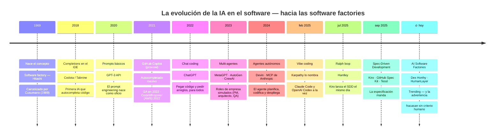

# Roadmap — Evolución de la IA hacia las software factories

Fuente: línea de tiempo verificada (investigación propia, fechas contra fuentes primarias)
+ cross-check con [13-sandgarden-evolution.md](13-sandgarden-evolution.md).
Lo marcado 🔥 es el *trending* actual según las fuentes.

## Notas de revisión

- Orden cronológico estricto con fechas (petición: primera parte de la charla = evolución en tiempo).
- **11 hitos**: los 10 verificados + el concepto industrial de 1969 que abre el gancho.
- 2024 agrupa Devin (mar) y MCP (nov); feb 2025 agrupa vibe coding con Claude Code/Codex para no trocear el año.
- El 🔥 hoy conecta directo con el bloque 3 (por qué fracasan, tesis de Dex Horthy).
- En la baraja, cada hito será una diapositiva-estación de la cinta de montaje con su referencia; este Mermaid es el mapa previo para revisar contenido, no el diseño final.
